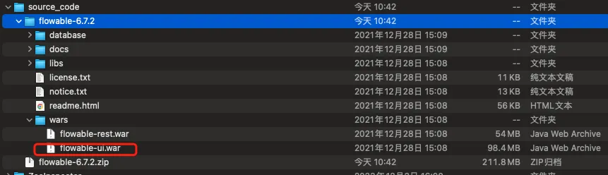
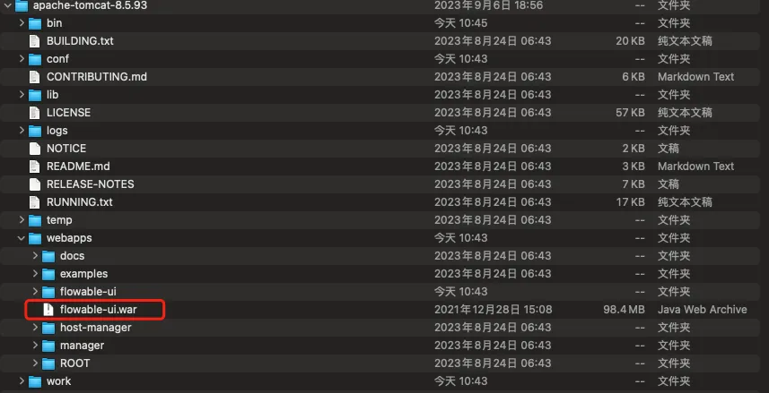
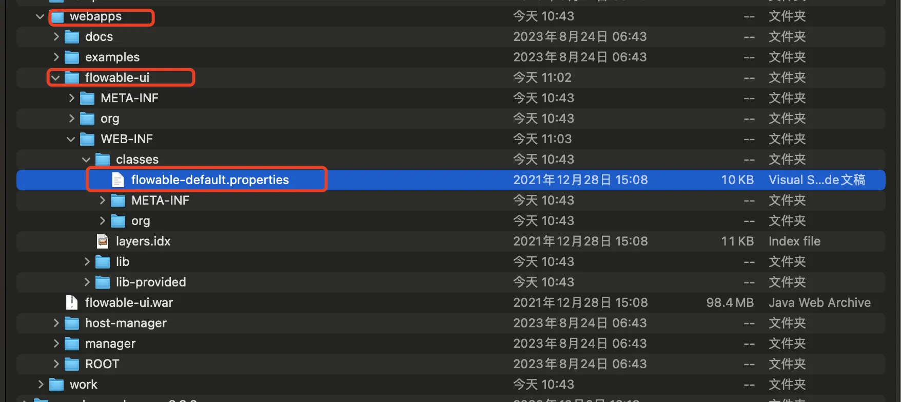
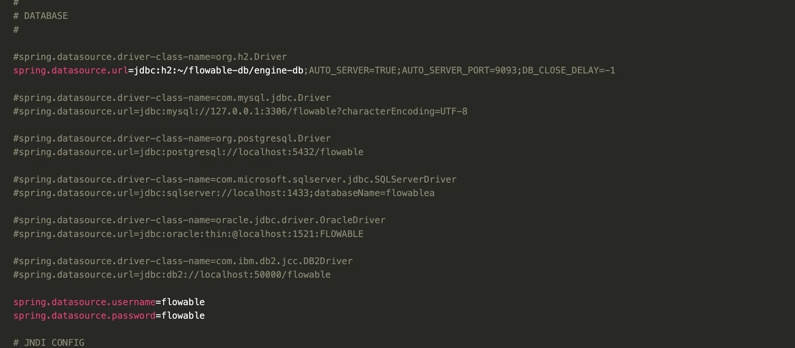

===========
Flowable
===========

Flowable UI
===============

下载 `Flowable Engine Releases <https://github.com/flowable/flowable-engine/releases>`_。

|image1|

|image2|

访问：http://localhost:8080/flowable-ui/#/ 

默认账号密码：

- 用户名： ``admin``
- 密码： ``test``

编辑 ``flowable-default.properties`` 可以修改 Flowable UI 的用户密码，端口号，数据库连接配置等。

|image3|

|image4|

.. code-block:: properties

  flowable.common.app.idm-admin.user=admin
  flowable.common.app.idm-admin.password=test

  flowable.experimental.debugger.enabled=false

Flowable 数据库表结构
========================

Flowable 数据库表命名规则
----------------------------

``ACT_RE_*``

    ``RE`` 表示 repository（存储）。RepositoryService 接口操作的表。
    带此前缀的表包含的是静态信息，如流程定义，流程的资源（图片，规则等）。

``ACT_RU_*``

    ``RU`` 表示 runtime。
    这是运行时的表，存储着流程变量，用户任务，变量，职责（job）等运行时的数据。
    Flowable 只存储实例执行期间的运行时数据，当流程实例结束时，将删除这些记录。
    这就保证了这些运行时的表小且快。

``ACT_ID_*``

    ``ID`` 表示 identity（组织机构）。
    这些表包含标识的信息，如用户，用户组，等等。

``ACT_HI_*``

    ``HI`` 表示 history。
    就是这些表包含着历史的相关数据，如结束的流程实例，变量，任务，等等。

``ACT_GE_*``

    普通数据，各种情况都使用的数据。

Flowable 从 6.4.1 开始，``ACT_DE_MODEL`` 代替原来的 ``ACT_RE_MODEL`` 表，
``ACT_RE_MODEL`` 将作废。

数据库表结构
----------------

34 张表，不同版本数量可能会有出入。

一般数据（2）
~~~~~~~~~~~~~

.. list-table::
   :header-rows: 1
   :widths: 35 65

   * - 表名
     - 说明
   * - ACT_GE_BYTEARRAY
     - 通用的流程定义和流程资源
   * - ACT_GE_PROPERTY
     - 系统相关属性

流程历史记录（8）
~~~~~~~~~~~~~~~~~

.. list-table::
   :header-rows: 1
   :widths: 35 65

   * - 表名
     - 说明
   * - ACT_HI_ACTINST
     - 历史的流程实例
   * - ACT_HI_ATTACHMENT
     - 历史的流程附件
   * - ACT_HI_COMMENT
     - 历史的说明性信息
   * - ACT_HI_DETAIL
     - 历史的流程运行中的细节信息
   * - ACT_HI_IDENTITYLINK
     - 历史的流程运行过程中用户关系
   * - ACT_HI_PROCINST
     - 历史的流程实例
   * - ACT_HI_TASKINST
     - 历史的任务实例
   * - ACT_HI_VARINST
     - 历史的流程运行中的变量信息

用户用户组表（9）
~~~~~~~~~~~~~~~~~

.. list-table::
   :header-rows: 1
   :widths: 35 65

   * - 表名
     - 说明
   * - ACT_ID_BYTEARRAY
     - 二进制数据表
   * - ACT_ID_GROUP
     - 用户组信息表
   * - ACT_ID_INFO
     - 用户信息详情表
   * - ACT_ID_MEMBERSHIP
     - 人与组关系表
   * - ACT_ID_PRIV
     - 权限表
   * - ACT_ID_PRIV_MAPPING
     - 用户或组权限关系表
   * - ACT_ID_PROPERTY
     - 属性表
   * - ACT_ID_TOKEN
     - 系统登录日志表
   * - ACT_ID_USER
     - 用户表

流程定义表（3）
~~~~~~~~~~~~~~~

Flowable 从 6.4.1 开始，``ACT_DE_MODEL`` 代替原来的 ``ACT_RE_MODEL`` 表，
``ACT_RE_MODEL`` 将作废。

.. list-table::
   :header-rows: 1
   :widths: 35 65

   * - 表名
     - 说明
   * - ACT_RE_DEPLOYMENT
     - 部署单元信息
   * - ACT_RE_MODEL
     - 模型信息
   * - ACT_RE_PROCDEF
     - 已部署的流程定义

运行实例表（10）
~~~~~~~~~~~~~~~~

.. list-table::
   :header-rows: 1
   :widths: 35 65

   * - 表名
     - 说明
   * - ACT_RU_DEADLETTER_JOB
     - 正在运行的任务表
   * - ACT_RU_EVENT_SUBSCR
     - 运行时事件
   * - ACT_RU_EXECUTION
     - 运行时流程执行实例
   * - ACT_RU_HISTORY_JOB
     - 历史作业表
   * - ACT_RU_IDENTITYLINK
     - 运行时用户关系信息
   * - ACT_RU_JOB
     - 运行时作业表
   * - ACT_RU_SUSPENDED_JOB
     - 暂停作业表
   * - ACT_RU_TASK
     - 运行时任务表
   * - ACT_RU_TIMER_JOB
     - 定时作业表
   * - ACT_RU_VARIABLE
     - 运行时变量表

其他表（2）
~~~~~~~~~~~

.. list-table::
   :header-rows: 1
   :widths: 35 65

   * - 表名
     - 说明
   * - ACT_EVT_LOG
     - 事件日志表
   * - ACT_PROCDEF_INFO
     - 流程定义信息

数据表详细说明
------------------

ACT_GE_BYTEARRAY 资源表
~~~~~~~~~~~~~~~~~~~~~~~~~~~

.. list-table::
   :header-rows: 1
   :widths: 18 20 10 20 32

   * - 字段
     - 类型
     - 主键
     - 说明
     - 备注
   * - ``ID_``
     - NVARCHAR2(64)
     - Y
     - 主键
     -
   * - ``REV_``
     - INTEGER
     - N
     - 数据版本
     - Activiti 有可能会被频繁修改数据库表，加入字段，用来表示该数据被操作的次数
   * - ``NAME_``
     - NVARCHAR2(255)
     - N
     - 资源名称
     -
   * - ``DEPLOYMENT_ID_``
     - NVARCHAR2(64)
     - N
     - 部署序号
     - 部署序号，一次部署可以部署多个资源，该字段与部署表 ACT_RE_DEPLOYMENT 的主键关联
   * - ``BYTES_``
     - BLOB
     - N
     - 资源内容
     -
   * - ``GENERATED_``
     - NUMBER(1)
     - N
     - 是否是右 Activiti 自动产生的资源
     - 0 表示 false，1 表示 true

ACT_GE_PROPERTY 属性表
~~~~~~~~~~~~~~~~~~~~~~~~~~

.. list-table::
   :header-rows: 1
   :widths: 18 20 10 20 32

   * - 字段
     - 类型
     - 主键
     - 说明
     - 备注
   * - ``NAME_``
     - NVARCHAR2(64)
     - Y
     - 属性名称
     -
   * - ``VALUE_``
     - NVARCHAR2(300)
     - N
     - 属性值
     -
   * - ``REV_``
     - INTEGER
     - N
     - 数据版本号
     -

ACT_RE_DEPLOYMENT 部署数据表
~~~~~~~~~~~~~~~~~~~~~~~~~~~~~~~~

.. list-table::
   :header-rows: 1
   :widths: 18 20 10 20 32

   * - 字段
     - 类型
     - 主键
     - 说明
     - 备注
   * - ``ID_``
     - NVARCHAR2(64)
     - Y
     - 部署序号
     -
   * - ``NAME_``
     - NVARCHAR2(255)
     - N
     - 部署名称
     -
   * - ``CATEGORY_``
     - NVARCHAR2(255)
     - N
     - 类别
     - 流程定义的 Namespace 就是类别
   * - ``KEY_``
     - NVARCHAR2(255)
     - N
     - 流程定义 ID
     -
   * - ``TENANT_ID_``
     - NVARCHAR2(255)
     - N
     -
     -
   * - ``DEPLOY_TIME_``
     - TIMESTAMP(6)
     - N
     - 部署时间
     -
   * - ``ENGINE_VERSION_``
     - NVARCHAR2(255)
     - N
     - 引擎版本
     -

ACT_RE_PROCDEF 流程定义表
~~~~~~~~~~~~~~~~~~~~~~~~~~~~~

.. list-table::
   :header-rows: 1
   :widths: 22 20 10 25 35

   * - 字段
     - 类型
     - 主键
     - 说明
     - 备注
   * - ``ID_``
     - NVARCHAR2(64)
     - Y
     - 主键
     -
   * - ``REV_``
     - INTEGER
     - N
     - 数据版本号
     -
   * - ``CATEGORY_``
     - NVARCHAR2(255)
     - N
     - 流程定义分类
     - 读取 xml 文件中程的 targetNamespace 值
   * - ``NAME_``
     - NVARCHAR2(255)
     - N
     - 流程定义的名称
     - 读取流程文件中 process 元素的 name 属性
   * - ``KEY_``
     - NVARCHAR2(255)
     - N
     - 流程定义 key
     - 读取流程文件中 process 元素的 id 属性
   * - ``VERSION_``
     - INTEGER
     - N
     - 版本
     -
   * - ``DEPLOYMENT_ID_``
     - NVARCHAR2(64)
     - N
     - 部署 ID
     - 流程定义对应的部署数据 ID
   * - ``RESOURCE_NAME_``
     - NVARCHAR2(2000)
     - N
     - bpmn 文件名称
     - 一般为流程文件的相对路径
   * - ``DGRM_RESOURCE_NAME_``
     - VARCHAR2(4000)
     - N
     - 流程定义对应的流程图资源名称
     -
   * - ``DESCRIPTION_``
     - NVARCHAR2(2000)
     - N
     - 说明
     -
   * - ``HAS_START_FORM_KEY_``
     - NUMBER(1)
     - N
     - 是否存在开始节点 formKey
     - start 节点是否存在 formKey 0 否 1 是
   * - ``HAS_GRAPHICAL_NOTATION_``
     - NUMBER(1)
     - N
     -
     -
   * - ``SUSPENSION_STATE_``
     - INTEGER
     - N
     - 流程定义状态
     - 1 激活、2 中止
   * - ``TENANT_ID_``
     - NVARCHAR2(255)
     - N
     -
     -
   * - ``ENGINE_VERSION_``
     - NVARCHAR2(255)
     - N
     -
     - 引擎版本

ACT_ID_USER 用户表
~~~~~~~~~~~~~~~~~~~~~~

.. list-table::
   :header-rows: 1
   :widths: 18 20 10 20 32

   * - 字段
     - 类型
     - 主键
     - 说明
     - 备注
   * - ``ID_``
     - NVARCHAR2(64)
     - Y
     - 主键
     -
   * - ``REV_``
     - INTEGER
     - N
     - 数据版本
     -
   * - ``FIRST_``
     - NVARCHAR2(255)
     - N
     - 人名
     -
   * - ``LAST_``
     - NVARCHAR2(255)
     - N
     - 姓氏
     -
   * - ``EMAIL_``
     - NVARCHAR2(255)
     - N
     - 邮件
     -
   * - ``PWD_``
     - NVARCHAR2(255)
     - N
     - 用户密码
     -
   * - ``PICTURE_ID_``
     - NVARCHAR2(64)
     - N
     - 图片 ID
     -

ACT_ID_INFO 用户信息表
~~~~~~~~~~~~~~~~~~~~~~~~~~

.. list-table::
   :header-rows: 1
   :widths: 18 20 10 20 32

   * - 字段
     - 类型
     - 主键
     - 说明
     - 备注
   * - ``ID_``
     - NVARCHAR2(64)
     - Y
     - 主键
     -
   * - ``REV_``
     - INTEGER
     - N
     - 数据版本
     -
   * - ``USER_ID_``
     - NVARCHAR2(64)
     - N
     - 对应用户表主键
     -
   * - ``TYPE_``
     - NVARCHAR2(64)
     - N
     - 信息类型
     - 当前可以设置用户帐号（account）、用户信息（userinfo）和 NULL 三种值
   * - ``KEY_``
     - NVARCHAR2(255)
     - N
     - 数据的键
     - 可以根据该键查找用户信息的值
   * - ``VALUE_``
     - NVARCHAR2(255)
     - N
     - 数据的值
     -
   * - ``PASSWORD_``
     - BLOB
     - N
     - 用户密码
     -
   * - ``PARENT_ID_``
     - NVARCHAR2(255)
     - N
     - 父信息 ID
     -

ACT_ID_GROUP 用户组表
~~~~~~~~~~~~~~~~~~~~~~~~~

.. list-table::
   :header-rows: 1
   :widths: 18 20 10 20 32

   * - 字段
     - 类型
     - 主键
     - 说明
     - 备注
   * - ``ID_``
     - NVARCHAR2(64)
     - Y
     - 主键
     -
   * - ``REV_``
     - INTEGER
     - N
     - 数据版本
     -
   * - ``NAME_``
     - NVARCHAR2(255)
     - N
     - 用户组名称
     -
   * - ``TYPE_``
     - NVARCHAR2(255)
     - N
     - 用户组类型
     -

ACT_ID_MEMBERSHIP 关系表
~~~~~~~~~~~~~~~~~~~~~~~~~~~

.. list-table::
   :header-rows: 1
   :widths: 18 20 10 20 32

   * - 字段
     - 类型
     - 主键
     - 说明
     - 备注
   * - ``USER_ID_``
     - NVARCHAR2(64)
     - Y
     - 用户 ID
     -
   * - ``GROUP_ID_``
     - NVARCHAR2(64)
     - Y
     - 用户组 ID
     -

ACT_RU_EXECUTION 流程实例（执行流）表
~~~~~~~~~~~~~~~~~~~~~~~~~~~~~~~~~~~~~~~~~

.. list-table::
   :header-rows: 1
   :widths: 24 20 10 46

   * - 字段
     - 类型
     - 主键
     - 说明
   * - ``ID_``
     - NVARCHAR2(64)
     - Y
     - 主键
   * - ``REV_``
     - INTEGER
     - N
     - 数据版本
   * - ``PROC_INST_ID_``
     - NVARCHAR2(64)
     - N
     - 流程实例 ID
   * - ``BUSINESS_KEY_``
     - NVARCHAR2(255)
     - N
     - 业务主键 ID
   * - ``PARENT_ID_``
     - NVARCHAR2(64)
     - N
     - 父执行流的 ID
   * - ``PROC_DEF_ID_``
     - NVARCHAR2(64)
     - N
     - 流程定义的数据 ID
   * - ``SUPER_EXEC_``
     - NVARCHAR2(64)
     - N
     -
   * - ``ROOT_PROC_INST_ID_``
     - NVARCHAR2(64)
     - N
     -
   * - ``ACT_ID_``
     - NVARCHAR2(255)
     - N
     - 节点实例 ID
   * - ``IS_ACTIVE_``
     - NUMBER(1)
     - N
     - 是否存活
   * - ``IS_CONCURRENT_``
     - NUMBER(1)
     - N
     - 执行流是否正在并行
   * - ``IS_SCOPE_``
     - NUMBER(1)
     - N
     -
   * - ``IS_EVENT_SCOPE_``
     - NUMBER(1)
     - N
     -
   * - ``IS_MI_ROOT_``
     - NUMBER(1)
     - N
     -
   * - ``SUSPENSION_STATE_``
     - INTEGER
     - N
     - 流程终端状态
   * - ``CACHED_ENT_STATE_``
     - INTEGER
     - N
     -
   * - ``TENANT_ID_``
     - NVARCHAR2(255)
     - N
     -
   * - ``NAME_``
     - NVARCHAR2(255)
     - N
     -
   * - ``START_TIME_``
     - TIMESTAMP(6)
     - N
     - 开始时间
   * - ``START_USER_ID_``
     - NVARCHAR2(255)
     - N
     -
   * - ``LOCK_TIME_``
     - TIMESTAMP(6)
     - N
     -
   * - ``IS_COUNT_ENABLED_``
     - NUMBER(1)
     - N
     -
   * - ``EVT_SUBSCR_COUNT_``
     - INTEGER
     - N
     -
   * - ``TASK_COUNT_``
     - INTEGER
     - N
     -
   * - ``JOB_COUNT_``
     - INTEGER
     - N
     -
   * - ``TIMER_JOB_COUNT_``
     - INTEGER
     - N
     -
   * - ``SUSP_JOB_COUNT_``
     - INTEGER
     - N
     -
   * - ``DEADLETTER_JOB_COUNT_``
     - INTEGER
     - N
     -
   * - ``VAR_COUNT_``
     - INTEGER
     - N
     -
   * - ``ID_LINK_COUNT_``
     - INTEGER
     - N
     -

ACT_RU_TASK 流程任务表
~~~~~~~~~~~~~~~~~~~~~~~~~~~

.. list-table::
   :header-rows: 1
   :widths: 24 20 10 46

   * - 字段
     - 类型
     - 主键
     - 说明
   * - ``ID_``
     - NVARCHAR2(64)
     - Y
     - 主键
   * - ``REV_``
     - INTEGER
     - N
     - 数据版本
   * - ``EXECUTION_ID_``
     - NVARCHAR2(64)
     - N
     - 任务所在的执行流 ID
   * - ``PROC_INST_ID_``
     - NVARCHAR2(64)
     - N
     - 流程实例 ID
   * - ``PROC_DEF_ID_``
     - NVARCHAR2(64)
     - N
     - 流程定义数据 ID
   * - ``NAME_``
     - NVARCHAR2(255)
     - N
     - 任务名称
   * - ``PARENT_TASK_ID_``
     - NVARCHAR2(64)
     - N
     - 父任务 ID
   * - ``DESCRIPTION_``
     - NVARCHAR2(2000)
     - N
     - 说明
   * - ``TASK_DEF_KEY_``
     - NVARCHAR2(255)
     - N
     - 任务定义的 ID 值
   * - ``OWNER_``
     - NVARCHAR2(255)
     - N
     - 任务拥有人
   * - ``ASSIGNEE_``
     - NVARCHAR2(255)
     - N
     - 被指派执行该任务的人
   * - ``DELEGATION_``
     - NVARCHAR2(64)
     - N
     -
   * - ``PRIORITY_``
     - INTEGER
     - N
     -
   * - ``CREATE_TIME_``
     - TIMESTAMP(6)
     - N
     - 创建时间
   * - ``DUE_DATE_``
     - TIMESTAMP(6)
     - N
     - 耗时
   * - ``CATEGORY_``
     - NVARCHAR2(255)
     - N
     -
   * - ``SUSPENSION_STATE_``
     - INTEGER
     - N
     - 是否挂起，1 代表激活，2 代表挂起
   * - ``TENANT_ID_``
     - NVARCHAR2(255)
     - N
     -
   * - ``FORM_KEY_``
     - NVARCHAR2(255)
     - N
     -
   * - ``CLAIM_TIME_``
     - TIMESTAMP(6)
     - N
     -

ACT_RU_VARIABLE 流程参数表
~~~~~~~~~~~~~~~~~~~~~~~~~~~~~~

.. list-table::
   :header-rows: 1
   :widths: 24 20 10 46

   * - 字段
     - 类型
     - 主键
     - 说明
   * - ``ID_``
     - NVARCHAR2(64)
     - Y
     - 主键
   * - ``REV_``
     - INTEGER
     - N
     - 数据版本
   * - ``TYPE_``
     - NVARCHAR2(255)
     - N
     - 参数类型，可以是基本的类型，也可以用户自行扩展
   * - ``NAME_``
     - NVARCHAR2(255)
     - N
     - 参数名称
   * - ``EXECUTION_ID_``
     - NVARCHAR2(64)
     - N
     - 参数执行 ID
   * - ``PROC_INST_ID_``
     - NVARCHAR2(64)
     - N
     - 流程实例 ID
   * - ``TASK_ID_``
     - NVARCHAR2(64)
     - N
     - 任务 ID
   * - ``BYTEARRAY_ID_``
     - NVARCHAR2(64)
     - N
     - 资源 ID
   * - ``DOUBLE_``
     - NUMBER(\*,10)
     - N
     - 参数为 double，则保存在该字段中
   * - ``LONG_``
     - NUMBER(19)
     - N
     - 参数为 long，则保存在该字段中
   * - ``TEXT_``
     - NVARCHAR2(2000)
     - N
     - 用户保存文本类型的参数值
   * - ``TEXT2_``
     - NVARCHAR2(2000)
     - N
     - 用户保存文本类型的参数值

ACT_RU_IDENTITYLINK 流程身份关系表
~~~~~~~~~~~~~~~~~~~~~~~~~~~~~~~~~~~~~~~

.. list-table::
   :header-rows: 1
   :widths: 24 20 10 46

   * - 字段
     - 类型
     - 主键
     - 说明
   * - ``ID_``
     - NVARCHAR2(64)
     - Y
     - 主键
   * - ``REV_``
     - INTEGER
     - N
     - 数据版本
   * - ``GROUP_ID_``
     - NVARCHAR2(255)
     - N
     - 用户组 ID
   * - ``TYPE_``
     - NVARCHAR2(255)
     - N
     - 关系数据类型，assignee 支配人（组）、candidate 候选人（组）、owner 拥有人
   * - ``USER_ID_``
     - NVARCHAR2(255)
     - N
     - 用户 ID
   * - ``TASK_ID_``
     - NVARCHAR2(64)
     - N
     - 任务 ID
   * - ``PROC_INST_ID_``
     - NVARCHAR2(64)
     - N
     - 流程定义 ID
   * - ``PROC_DEF_ID_``
     - NVARCHAR2(64)
     - N
     - 属性 ID

ACT_RU_JOB 工作数据表（一般工作表）
~~~~~~~~~~~~~~~~~~~~~~~~~~~~~~~~~~~~~~~

.. list-table::
   :header-rows: 1
   :widths: 24 20 10 46

   * - 字段
     - 类型
     - 主键
     - 说明
   * - ``ID_``
     - NVARCHAR2(64)
     - Y
     - 主键
   * - ``REV_``
     - INTEGER
     - N
     - 数据版本
   * - ``TYPE_``
     - NVARCHAR2(255)
     - N
     - 类型
   * - ``LOCK_EXP_TIME_``
     - TIMESTAMP(6)
     - N
     - 锁定释放时间
   * - ``LOCK_OWNER_``
     - NVARCHAR2(255)
     - N
     - 挂起者
   * - ``EXCLUSIVE_``
     - NUMBER(1)
     - N
     -
   * - ``EXECUTION_ID_``
     - NVARCHAR2(64)
     - N
     - 执行实例 ID
   * - ``PROCESS_INSTANCE_ID_``
     - NVARCHAR2(64)
     - N
     - 流程实例 ID
   * - ``PROC_DEF_ID_``
     - NVARCHAR2(64)
     - N
     - 流程定义 ID
   * - ``RETRIES_``
     - INTEGER
     - N
     -
   * - ``EXCEPTION_STACK_ID_``
     - NVARCHAR2(64)
     - N
     - 异常信息 ID
   * - ``EXCEPTION_MSG_``
     - NVARCHAR2(2000)
     - N
     - 异常信息
   * - ``DUEDATE_``
     - TIMESTAMP(6)
     - N
     - 到期时间
   * - ``REPEAT_``
     - NVARCHAR2(255)
     - N
     - 重复
   * - ``HANDLER_TYPE_``
     - NVARCHAR2(255)
     - N
     - 处理类型
   * - ``HANDLER_CFG_``
     - NVARCHAR2(2000)
     - N
     -
   * - ``TENANT_ID_``
     - NVARCHAR2(255)
     - N
     -

ACT_RU_DEADLETTER_JOB 工作数据表（无法执行工作表）
~~~~~~~~~~~~~~~~~~~~~~~~~~~~~~~~~~~~~~~~~~~~~~~~~~~~~~

.. list-table::
   :header-rows: 1
   :widths: 24 20 10 46

   * - 字段
     - 类型
     - 主键
     - 说明
   * - ``ID_``
     - NVARCHAR2(64)
     - Y
     - 主键
   * - ``REV_``
     - INTEGER
     - N
     - 数据版本
   * - ``TYPE_``
     - NVARCHAR2(255)
     - N
     - 类型
   * - ``EXCLUSIVE_``
     - NUMBER(1)
     - N
     -
   * - ``EXECUTION_ID_``
     - NVARCHAR2(64)
     - N
     - 执行实例 ID
   * - ``PROCESS_INSTANCE_ID_``
     - NVARCHAR2(64)
     - N
     - 流程实例 ID
   * - ``PROC_DEF_ID_``
     - NVARCHAR2(64)
     - N
     - 流程定义 ID
   * - ``RETRIES_``
     - INTEGER
     - N
     -
   * - ``EXCEPTION_STACK_ID_``
     - NVARCHAR2(64)
     - N
     - 异常信息 ID
   * - ``EXCEPTION_MSG_``
     - NVARCHAR2(2000)
     - N
     - 异常信息
   * - ``DUEDATE_``
     - TIMESTAMP(6)
     - N
     - 到期时间
   * - ``REPEAT_``
     - NVARCHAR2(255)
     - N
     - 重复
   * - ``HANDLER_TYPE_``
     - NVARCHAR2(255)
     - N
     - 处理类型
   * - ``HANDLER_CFG_``
     - NVARCHAR2(2000)
     - N
     -
   * - ``TENANT_ID_``
     - NVARCHAR2(255)
     - N
     -

ACT_RU_SUSPENDED_JOB 工作数据表（暂停工作表）
~~~~~~~~~~~~~~~~~~~~~~~~~~~~~~~~~~~~~~~~~~~~~~~~

.. list-table::
   :header-rows: 1
   :widths: 24 20 10 46

   * - 字段
     - 类型
     - 主键
     - 说明
   * - ``ID_``
     - NVARCHAR2(64)
     - Y
     - 主键
   * - ``REV_``
     - INTEGER
     - N
     - 数据版本
   * - ``TYPE_``
     - NVARCHAR2(255)
     - N
     - 类型
   * - ``EXCLUSIVE_``
     - NUMBER(1)
     - N
     -
   * - ``EXECUTION_ID_``
     - NVARCHAR2(64)
     - N
     - 执行实例 ID
   * - ``PROCESS_INSTANCE_ID_``
     - NVARCHAR2(64)
     - N
     - 流程实例 ID
   * - ``PROC_DEF_ID_``
     - NVARCHAR2(64)
     - N
     - 流程定义 ID
   * - ``RETRIES_``
     - INTEGER
     - N
     -
   * - ``EXCEPTION_STACK_ID_``
     - NVARCHAR2(64)
     - N
     - 异常信息 ID
   * - ``EXCEPTION_MSG_``
     - NVARCHAR2(2000)
     - N
     - 异常信息
   * - ``DUEDATE_``
     - TIMESTAMP(6)
     - N
     - 到期时间
   * - ``REPEAT_``
     - NVARCHAR2(255)
     - N
     - 重复
   * - ``HANDLER_TYPE_``
     - NVARCHAR2(255)
     - N
     - 处理类型
   * - ``HANDLER_CFG_``
     - NVARCHAR2(2000)
     - N
     -
   * - ``TENANT_ID_``
     - NVARCHAR2(255)
     - N
     -

ACT_RU_TIMER_JOB 工作数据表（定时工作表）
~~~~~~~~~~~~~~~~~~~~~~~~~~~~~~~~~~~~~~~~~~~~

.. list-table::
   :header-rows: 1
   :widths: 24 20 10 46

   * - 字段
     - 类型
     - 主键
     - 说明
   * - ``ID_``
     - NVARCHAR2(64)
     - Y
     - 主键
   * - ``REV_``
     - INTEGER
     - N
     - 数据版本
   * - ``TYPE_``
     - NVARCHAR2(255)
     - N
     - 类型
   * - ``EXCLUSIVE_``
     - NUMBER(1)
     - N
     -
   * - ``EXECUTION_ID_``
     - NVARCHAR2(64)
     - N
     - 执行实例 ID
   * - ``PROCESS_INSTANCE_ID_``
     - NVARCHAR2(64)
     - N
     - 流程实例 ID
   * - ``PROC_DEF_ID_``
     - NVARCHAR2(64)
     - N
     - 流程定义 ID
   * - ``RETRIES_``
     - INTEGER
     - N
     -
   * - ``EXCEPTION_STACK_ID_``
     - NVARCHAR2(64)
     - N
     - 异常信息 ID
   * - ``EXCEPTION_MSG_``
     - NVARCHAR2(2000)
     - N
     - 异常信息
   * - ``DUEDATE_``
     - TIMESTAMP(6)
     - N
     - 到期时间
   * - ``REPEAT_``
     - NVARCHAR2(255)
     - N
     - 重复
   * - ``HANDLER_TYPE_``
     - NVARCHAR2(255)
     - N
     - 处理类型
   * - ``HANDLER_CFG_``
     - NVARCHAR2(2000)
     - N
     -
   * - ``TENANT_ID_``
     - NVARCHAR2(255)
     - N
     -

ACT_RU_EVENT_SUBSCR 时间描述表
~~~~~~~~~~~~~~~~~~~~~~~~~~~~~~~~~~

.. list-table::
   :header-rows: 1
   :widths: 24 20 10 46

   * - 字段
     - 类型
     - 主键
     - 说明
   * - ``ID_``
     - NVARCHAR2(64)
     - Y
     - 主键
   * - ``REV_``
     - INTEGER
     - N
     - 数据版本
   * - ``EVENT_TYPE_``
     - NVARCHAR2(255)
     - N
     - 事件类型
   * - ``EVENT_NAME_``
     - NVARCHAR2(255)
     - N
     - 事件名称
   * - ``EXECUTION_ID_``
     - NVARCHAR2(64)
     - N
     - 指定 ID
   * - ``PROC_INST_ID_``
     - NVARCHAR2(64)
     - N
     - 流程定义 ID
   * - ``ACTIVITY_ID_``
     - NVARCHAR2(64)
     - N
     - 具体事件 ID
   * - ``CONFIGURATION_``
     - NVARCHAR2(255)
     - N
     - 事件的配置属性
   * - ``CREATED_``
     - TIMESTAMP(6)
     - N
     - 创建时间
   * - ``PROC_DEF_ID_``
     - NVARCHAR2(64)
     - N
     - 属性 ID
   * - ``TENANT_ID_``
     - NVARCHAR2(255)
     - N
     -

ACT_HI_PROCINST 流程实例表
~~~~~~~~~~~~~~~~~~~~~~~~~~~~~~~

.. list-table::
   :header-rows: 1
   :widths: 30 20 10 40

   * - 字段
     - 类型
     - 主键
     - 说明
   * - ``ID_``
     - NVARCHAR2(64)
     - Y
     - 主键
   * - ``PROC_INST_ID_``
     - NVARCHAR2(64)
     - N
     - 流程实例 ID
   * - ``BUSINESS_KEY_``
     - NVARCHAR2(255)
     - N
     - 业务主键
   * - ``PROC_DEF_ID_``
     - NVARCHAR2(64)
     - N
     - 属性 ID
   * - ``START_TIME_``
     - TIMESTAMP(6)
     - N
     - 开始时间
   * - ``END_TIME_``
     - TIMESTAMP(6)
     - N
     - 结束时间
   * - ``DURATION_``
     - NUMBER(19)
     - N
     - 耗时
   * - ``START_USER_ID_``
     - NVARCHAR2(255)
     - N
     - 起始人
   * - ``START_ACT_ID_``
     - NVARCHAR2(255)
     - N
     - 起始节点
   * - ``END_ACT_ID_``
     - NVARCHAR2(255)
     - N
     - 结束节点
   * - ``SUPER_PROCESS_INSTANCE_ID_``
     - NVARCHAR2(64)
     - N
     - 父流程实例 ID
   * - ``DELETE_REASON_``
     - NVARCHAR2(2000)
     - N
     - 删除原因
   * - ``TENANT_ID_``
     - NVARCHAR2(255)
     - N
     -
   * - ``NAME_``
     - NVARCHAR2(255)
     - N
     - 名称

ACT_HI_DETAIL 流程明细表
~~~~~~~~~~~~~~~~~~~~~~~~~~~~~

.. list-table::
   :header-rows: 1
   :widths: 24 20 10 46

   * - 字段
     - 类型
     - 主键
     - 说明
   * - ``ID_``
     - NVARCHAR2(64)
     - Y
     - 主键
   * - ``REV_``
     - INTEGER
     - N
     - 数据版本
   * - ``TYPE_``
     - NVARCHAR2(255)
     - N
     - 类型
   * - ``PROC_INST_ID_``
     - NVARCHAR2(64)
     - N
     - 流程实例 ID
   * - ``EXECUTION_ID_``
     - NVARCHAR2(64)
     - N
     - 执行 ID
   * - ``TASK_ID_``
     - NVARCHAR2(64)
     - N
     - 任务 ID
   * - ``ACT_INST_ID_``
     - NVARCHAR2(64)
     - N
     - 节点实例 ID
   * - ``NAME_``
     - NVARCHAR2(255)
     - N
     - 名称
   * - ``VAR_TYPE_``
     - NVARCHAR2(64)
     - N
     - 参数类型
   * - ``TIME_``
     - TIMESTAMP(6)
     - N
     - 时间戳
   * - ``BYTEARRAY_ID_``
     - NVARCHAR2(64)
     - N
     - 字节表 ID
   * - ``DOUBLE_``
     - NUMBER(\*,10)
     - N
     - 存储变量类型为 Double
   * - ``LONG_``
     - NUMBER(19)
     - N
     - 存储变量类型为 long
   * - ``TEXT_``
     - NVARCHAR2(2000)
     - N
     - 存储变量值类型为 String
   * - ``TEXT2_``
     - NVARCHAR2(2000)
     - N
     - 此处存储的是 JPA 持久化对象时，才会有值。此值为对象 ID

ACT_HI_TASKINST 历史任务表
~~~~~~~~~~~~~~~~~~~~~~~~~~~~~~

.. list-table::
   :header-rows: 1
   :widths: 24 20 10 46

   * - 字段
     - 类型
     - 主键
     - 说明
   * - ``ID_``
     - NVARCHAR2(64)
     - Y
     - 主键
   * - ``PROC_DEF_ID_``
     - NVARCHAR2(64)
     - N
     - 流程定义 ID
   * - ``TASK_DEF_KEY_``
     - NVARCHAR2(255)
     - N
     - 任务定义的 ID 值
   * - ``PROC_INST_ID_``
     - NVARCHAR2(64)
     - N
     - 流程实例 ID
   * - ``EXECUTION_ID_``
     - NVARCHAR2(64)
     - N
     - 执行 ID
   * - ``PARENT_TASK_ID_``
     - NVARCHAR2(64)
     - N
     - 父任务 ID
   * - ``NAME_``
     - NVARCHAR2(255)
     - N
     - 名称
   * - ``DESCRIPTION_``
     - NVARCHAR2(2000)
     - N
     - 说明
   * - ``OWNER_``
     - NVARCHAR2(255)
     - N
     - 实际签收人，任务的拥有者
   * - ``ASSIGNEE_``
     - NVARCHAR2(255)
     - N
     - 被指派执行该任务的人
   * - ``START_TIME_``
     - TIMESTAMP(6)
     - N
     - 开始时间
   * - ``CLAIM_TIME_``
     - TIMESTAMP(6)
     - N
     - 提醒时间
   * - ``END_TIME_``
     - TIMESTAMP(6)
     - N
     - 结束时间
   * - ``DURATION_``
     - NUMBER(19)
     - N
     - 耗时
   * - ``DELETE_REASON_``
     - NVARCHAR2(2000)
     - N
     - 删除原因
   * - ``PRIORITY_``
     - INTEGER
     - N
     - 优先级别
   * - ``DUE_DATE_``
     - TIMESTAMP(6)
     - N
     - 过期时间
   * - ``FORM_KEY_``
     - NVARCHAR2(255)
     - N
     - 节点定义的 formkey
   * - ``CATEGORY_``
     - NVARCHAR2(255)
     - N
     - 类别
   * - ``TENANT_ID_``
     - NVARCHAR2(255)
     - N
     -

ACT_HI_ACTINST 历史行为表
~~~~~~~~~~~~~~~~~~~~~~~~~~~~~~

.. list-table::
   :header-rows: 1
   :widths: 24 20 10 46

   * - 字段
     - 类型
     - 主键
     - 说明
   * - ``ID_``
     - NVARCHAR2(64)
     - Y
     - 主键
   * - ``PROC_DEF_ID_``
     - NVARCHAR2(64)
     - N
     - 流程定义 ID
   * - ``PROC_INST_ID_``
     - NVARCHAR2(64)
     - N
     - 流程实例 ID
   * - ``EXECUTION_ID_``
     - NVARCHAR2(64)
     - N
     - 执行 ID
   * - ``ACT_ID_``
     - NVARCHAR2(255)
     - N
     - 节点实例 ID
   * - ``TASK_ID_``
     - NVARCHAR2(64)
     - N
     - 任务 ID
   * - ``CALL_PROC_INST_ID_``
     - NVARCHAR2(64)
     - N
     - 调用外部的流程实例 ID
   * - ``ACT_NAME_``
     - NVARCHAR2(255)
     - N
     - 节点名称
   * - ``ACT_TYPE_``
     - NVARCHAR2(255)
     - N
     - 节点类型
   * - ``ASSIGNEE_``
     - NVARCHAR2(255)
     - N
     - 节点签收人
   * - ``START_TIME_``
     - TIMESTAMP(6)
     - N
     - 开始时间
   * - ``END_TIME_``
     - TIMESTAMP(6)
     - N
     - 结束时间
   * - ``DURATION_``
     - NUMBER(19)
     - N
     - 耗时
   * - ``DELETE_REASON_``
     - NVARCHAR2(2000)
     - N
     - 删除原因
   * - ``TENANT_ID_``
     - NVARCHAR2(255)
     - N
     -

ACT_HI_ATTACHMENT 附件表
~~~~~~~~~~~~~~~~~~~~~~~~~~~~~

.. list-table::
   :header-rows: 1
   :widths: 24 20 10 46

   * - 字段
     - 类型
     - 主键
     - 说明
   * - ``ID_``
     - NVARCHAR2(64)
     - Y
     - 主键
   * - ``REV_``
     - INTEGER
     - N
     - 数据版本
   * - ``USER_ID_``
     - NVARCHAR2(255)
     - N
     - 用户 ID
   * - ``NAME_``
     - NVARCHAR2(255)
     - N
     - 名称
   * - ``DESCRIPTION_``
     - NVARCHAR2(2000)
     - N
     - 说明
   * - ``TYPE_``
     - NVARCHAR2(255)
     - N
     - 类型
   * - ``TASK_ID_``
     - NVARCHAR2(64)
     - N
     - 任务 ID
   * - ``PROC_INST_ID_``
     - NVARCHAR2(64)
     - N
     - 流程实例 ID
   * - ``URL_``
     - NVARCHAR2(2000)
     - N
     -
   * - ``CONTENT_ID_``
     - NVARCHAR2(64)
     - N
     - 字节表的 ID
   * - ``TIME_``
     - TIMESTAMP(6)
     - N
     - 时间

ACT_HI_COMMENT 评论表
~~~~~~~~~~~~~~~~~~~~~~~~~~

.. list-table::
   :header-rows: 1
   :widths: 24 20 10 46

   * - 字段
     - 类型
     - 主键
     - 说明
   * - ``ID_``
     - NVARCHAR2(64)
     - Y
     - 主键
   * - ``TYPE_``
     - NVARCHAR2(255)
     - N
     - 类型，类型：event（事件）、comment（意见）
   * - ``TIME_``
     - TIMESTAMP(6)
     - N
     - 时间
   * - ``USER_ID_``
     - NVARCHAR2(255)
     - N
     - 用户 ID
   * - ``TASK_ID_``
     - NVARCHAR2(64)
     - N
     - 任务 ID
   * - ``PROC_INST_ID_``
     - NVARCHAR2(64)
     - N
     - 流程实例 ID
   * - ``ACTION_``
     - NVARCHAR2(255)
     - N
     - 行为类型
   * - ``MESSAGE_``
     - NVARCHAR2(2000)
     - N
     - 信息，用于存放流程产生的信息，比如审批意见
   * - ``FULL_MSG_``
     - BLOB
     - N
     - 全部内容

ACT_RE_MODEL 流程设计模型部署表
~~~~~~~~~~~~~~~~~~~~~~~~~~~~~~~~~~~~

.. list-table::
   :header-rows: 1
   :widths: 24 20 10 46

   * - 字段
     - 类型
     - 主键
     - 说明
   * - ``ID_``
     - NVARCHAR2(64)
     - Y
     - 主键
   * - ``REV_``
     - INTEGER
     - N
     - 数据版本
   * - ``NAME_``
     - NVARCHAR2(255)
     - N
     -
   * - ``KEY_``
     - NVARCHAR2(255)
     - N
     -
   * - ``CATEGORY_``
     - NVARCHAR2(255)
     - N
     - 分类
   * - ``CREATE_TIME_``
     - TIMESTAMP(6)
     - N
     - 创建时间
   * - ``LAST_UPDATE_TIME_``
     - TIMESTAMP(6)
     - N
     - 最后更新时间
   * - ``VERSION_``
     - INTEGER
     - N
     - 版本
   * - ``META_INFO_``
     - NVARCHAR2(2000)
     - N
     - 以 json 格式保存流程定义的信息
   * - ``DEPLOYMENT_ID_``
     - NVARCHAR2(64)
     - N
     - 部署 ID
   * - ``EDITOR_SOURCE_VALUE_ID_``
     - NVARCHAR2(64)
     - N
     -
   * - ``EDITOR_SOURCE_EXTRA_VALUE_ID_``
     - NVARCHAR2(64)
     - N
     -
   * - ``TENANT_ID_``
     - NVARCHAR2(255)
     - N
     -

ACT_EVT_LOG 事件日志表
~~~~~~~~~~~~~~~~~~~~~~~~~~~

.. list-table::
   :header-rows: 1
   :widths: 24 20 10 46

   * - 字段
     - 类型
     - 主键
     - 说明
   * - ``LOG_NR_``
     - NUMBER(19)
     - Y
     - 主键
   * - ``TYPE_``
     - NVARCHAR2(64)
     - N
     - 类型
   * - ``PROC_DEF_ID_``
     - NVARCHAR2(64)
     - N
     - 流程定义 ID
   * - ``PROC_INST_ID_``
     - NVARCHAR2(64)
     - N
     - 流程实例 ID
   * - ``EXECUTION_ID_``
     - NVARCHAR2(64)
     - N
     - 执行 ID
   * - ``TASK_ID_``
     - NVARCHAR2(64)
     - N
     - 任务 ID
   * - ``TIME_STAMP_``
     - TIMESTAMP(6)
     - N
     -
   * - ``USER_ID_``
     - NVARCHAR2(255)
     - N
     -
   * - ``DATA_``
     - BLOB
     - N
     -
   * - ``LOCK_OWNER_``
     - NVARCHAR2(255)
     - N
     -
   * - ``LOCK_TIME_``
     - TIMESTAMP(6)
     - N
     -
   * - ``IS_PROCESSED_``
     - NUMBER(3)
     - N
     -

ACT_PROCDEF_INFO
~~~~~~~~~~~~~~~~~~~~

.. list-table::
   :header-rows: 1
   :widths: 24 20 10 46

   * - 字段
     - 类型
     - 主键
     - 说明
   * - ``ID_``
     - NVARCHAR2(64)
     - Y
     - 主键
   * - ``PROC_DEF_ID_``
     - NVARCHAR2(64)
     - N
     - 流程定义 ID
   * - ``REV_``
     - INTEGER
     - N
     - 数据版本
   * - ``INFO_JSON_ID_``
     - NVARCHAR2(64)
     - N
     -

ACT_HI_VARINST 历史变量表
~~~~~~~~~~~~~~~~~~~~~~~~~~~~~~

.. list-table::
   :header-rows: 1
   :widths: 24 20 10 46

   * - 字段
     - 类型
     - 主键
     - 说明
   * - ``ID_``
     - NVARCHAR2(64)
     - Y
     - 主键
   * - ``PROC_INST_ID_``
     - NVARCHAR2(64)
     - N
     - 流程实例 ID
   * - ``EXECUTION_ID_``
     - NVARCHAR2(64)
     - N
     - 指定 ID
   * - ``TASK_ID_``
     - NVARCHAR2(64)
     - N
     - 任务 ID
   * - ``NAME_``
     - NVARCHAR2(255)
     - N
     - 名称
   * - ``VAR_TYPE_``
     - NVARCHAR2(100)
     - N
     - 参数类型
   * - ``REV_``
     - INTEGER
     - N
     - 数据版本
   * - ``BYTEARRAY_ID_``
     - NVARCHAR2(64)
     - N
     - 字节表 ID
   * - ``DOUBLE_``
     - NUMBER(*,10)
     - N
     - 存储 double 类型数据
   * - ``LONG_``
     - NUMBER(*,10)
     - N
     - 存储 long 类型数据
   * - ``TEXT_``
     - NVARCHAR2(2000)
     - N
     -
   * - ``TEXT2_``
     - NVARCHAR2(2000)
     - N
     -
   * - ``CREATE_TIME_``
     - TIMESTAMP(6)(2000)
     - N
     -
   * - ``LAST_UPDATED_TIME_``
     - TIMESTAMP(6)(2000)
     - N
     -

ACT_HI_IDENTITYLINK 历史流程人员表
~~~~~~~~~~~~~~~~~~~~~~~~~~~~~~~~~~~~~~~

.. list-table::
   :header-rows: 1
   :widths: 24 20 10 46

   * - 字段
     - 类型
     - 主键
     - 说明
   * - ``ID_``
     - NVARCHAR2(64)
     - Y
     - 主键
   * - ``GROUP_ID_``
     - NVARCHAR2(255)
     - N
     - 组 ID
   * - ``TYPE_``
     - NVARCHAR2(255)
     - N
     - 类型
   * - ``USER_ID_``
     - NVARCHAR2(255)
     - N
     - 用户 ID
   * - ``TASK_ID_``
     - NVARCHAR2(64)
     - N
     - 任务 ID
   * - ``PROC_INST_ID_``
     - NVARCHAR2(64)
     - N
     - 流程实例 ID

